# Обучение MNIST на малоразмеченных данных

## Аннотация

В работе исследуется задача классификации рукописных цифр MNIST при небольшом количестве размеченных изображений. Для ее решения рассматриваются несколько архитектур, использующих для обучения и размеченные и неразмеченные данные.

Пространство эмбеддингов намеренно ограничено двумя измерениями. Это позволяет визуализировать расположение изображений разных классов и анализировать формирование кластеров, хотя такое ограничение потенциально снижает точность моделей.

В лучших экспериментах получено **90,52% accuracy при 1% разметки** и **95,70% при 10%**. При одинаковом двумерном ограничении исследованные модели показали более высокую точность, чем контрольная CNN, обученная только на размеченных изображениях.

## 1. Введение и методика

### 1.1 Введение

**Основная цель этого проекта** -- исследовать методы классификации нейросетью, обученмой на малоразмеченных данных. 

В качестве датасета был выбран **MNIST** как классический и наглядный пример для классификации изображений.

MNIST содержит 70 000 изображений рукописных цифр размером 28×28. Из них 60 000 составляют исходную обучающую выборку, еще 10 000 -- тестовую. Наша задача -- добиться хорошей точности, используя метки только для небольшой части обучающих изображений.

Для наглядности я сознательно ограничил пространство эмбеддингов двумя измерениями. Так можно увидеть, как сеть располагает цифры в скрытом пространстве, хотя такое сильное сжатие эмбеддингов потенциально ограничивает точность модели.

### 1.2 Как это работает?

1. Сначала **энкодер** (сверточная сеть) переводит изображение 28×28 в двумерный вектор -- **эмбеддинг** с координатами (x, y). 
2. В пространстве эмбеддингов мы надеемся увидеть группы близко расположенных точек -- **кластеры**.
3. Предполагаем, что точки одного класса чаще оказываются рядом. Тогда даже небольшое количество разметки позволяет связать области пространства с конкретными классами.
4. Новое изображение переводится в эмбеддинг, после чего его класс определяется по ближайшим размеченным соседям или с помощью классификатора.

И все, успех!.. Чисто в теории...

При идеально точном делении на кластеры нам достаточно знать всего лишь по одному представителю каждого класса, и этого будет достаточно для предсказаний. Конечно, такого разделения добиться почти невозможно, поэтому мы будет брать большее количество размеченных изображений.

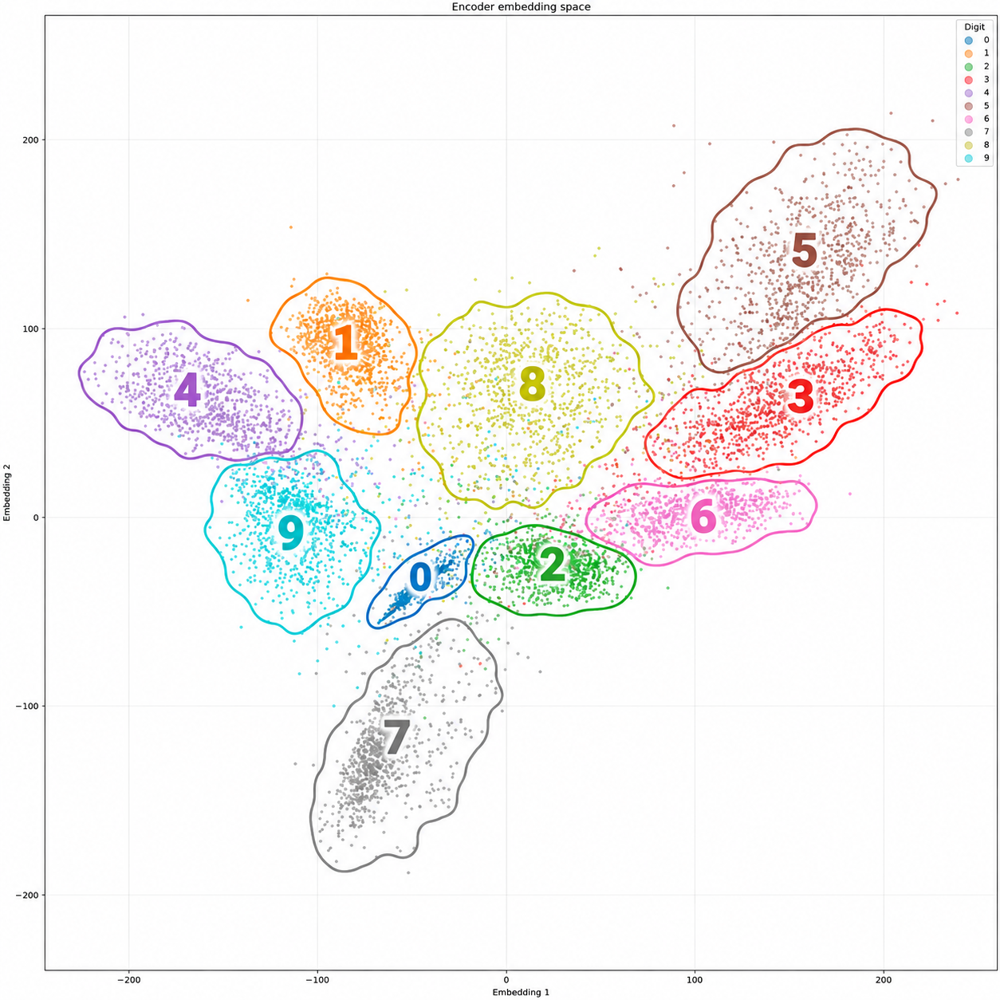

### 1.3 Методика эксперимента

Для моделирования частичной разметки данных из датасета случайным образом выбирались изображения, метки для которых стирались. Таким образом, датасет был разбит на размеченную часть (меньшую из двух) и неразмеченную часть.

Для воспроизведения одинаковой разметки данных в нескольких запусках использовалось одинаковое семя  генерации псевдослучайных чисел (seeed). Все модели в работе обучались и тестировались с одинаковым seed, что гарантирует идентичность размеченных изображений. 

Обучающая и тестовая выборки были разделены и содержали 55 000 и 10 000 изображений соответственно. Еще 5000 изображений относились к валидационной выборке, которая использовалась для подбора гиперпараметров модели (таких как коэффициенты критериев в функции потерь) и подсчета показателей loss и accuracy во время обучения сети.

```text
MNIST (70 000)
├── Train       55 000
├── Validation   5 000
└── Test        10 000
```

**Все исследованные архитектуры переводят изображение в 2-мерное скрытое пространство.** \
Это сознательное ограничение, благодаря ему мы можем отчетливо видеть, как сеть располагает разные цифры в скрытом пространстве, но такое сильное сжатие потенциально уменьшает accuracy.

## 2. Развитие архитектуры

### 2.1 Как определять классы по эмбеддингам?

Основной алгоритм -- **kNN (k nearest neighbors)**, или метод k ближайших соседей. Для нового эмбеддинга он находит k ближайших размеченных точек и выбирает наиболее частый среди них класс.

Заметим, что kNN **не выделяет кластеры явно**, а лишь классифицирует точку по соседям, поэтому может работать даже при довольно размытых границах кластеров.

#### Выбор оптимального значения k

Эксперименты показывают, что на хорошо разделенных эмбеддингах точность мало зависит от k в разумном диапазоне.

Однако, при больших k точность становится хуже, так как радиус поиска соседей начинает захватывать несколько кластеров сразу. К тому же большие значения k требуеют длительного перебора всех соседей, что негативно сказывается на скорости предсказаний.

В свою очередь, низкие значения k могут показывать нестабильный результат для моделей с плохой выраженностью кластеров. 
  
Таким образом, был выбран k = 10 как компромисс между стабильностью результата и скоростью работы. 

*Модель с классификатором:*

| Доля разметки | k=1 | k=3 | k=5 | k=10 | k=15 | k=25 | k=50 |
|---|---:|---:|---:|---:|---:|---:|---:|
| 1% | 76.25 | 78.20 | **78.49** | 77.80 | 77.61 | 76.25 | 74.14 |
| 2% | 88.88 | 89.32 | **89.42** | 89.17 | 89.06 | 88.51 | 87.46 |
| 3% | 89.72 | 90.07 | 90.27 | **90.38** | 90.37 | 90.35 | 90.08 |
| 5% | 88.88 | 89.42 | 89.73 | 90.07 | **90.10** | 90.07 | 89.69 |
| 10% | 93.27 | 93.72 | 93.87 | **93.94** | 93.84 | 93.79 | 93.73 |

*Наивный автоэнкодер:*

| Доля разметки | k=1 | k=3 | k=5 | k=10 | k=15 | k=25 | k=50 |
|---|---:|---:|---:|---:|---:|---:|---:|
| 1% | 75.10 | 76.99 | **78.20** | 75.52 | 75.03 | 72.60 | 68.42 |
| 2% | 75.73 | 78.15 | **79.40** | 79.36 | 79.06 | 76.89 | 73.37 |
| 3% | 75.40 | 78.14 | 79.45 | **79.72** | 79.30 | 78.79 | 75.28 |
| 5% | 75.02 | 78.68 | 79.76 | **80.27** | 79.94 | 79.73 | 78.21 |
| 10% | 75.96 | 78.84 | 80.32 | **81.29** | 80.86 | 80.58 | 80.72 |


#### **Какие есть альтернативы?**

- **K-means** -- разбивает точки на заданное количество кластеров, стараясь минимизировать расстояния до их центров. Однако если кластеры сильно вытянуты или пересекаются, метод может работать плохо. \
Как показали эксперименты, для наших эмбеддингов он работает ужасно. 
****
- **DBSCAN** -- ищет области с высокой плотностью точек, не требуя заранее задавать количество кластеров. Но результат сильно зависит от параметров алгоритма.

В итоге для основного бенчмаркинга был выбран **kNN** — из-за простоты реализации и хороших результатов на наших эмбеддингах.

Также в работе исследуется еще один предсказательный алгоритм: 
- **Классификатор** -- если модель содержит отдельную классификационную голову, можно использовать ее предсказания напрямую, вообще не прибегая к алгоритмам кластеризации.

### 2.2 Наивный автоэнкодер

<b><u>Гипотеза:</u></b>  для базовой реализации идеи, описанной выше, достаточно обучить простенький автоэнкодер. Энкодер будет сжимать картинку до двух чисел, а декодер -- пытаться восстановить исходное изображение из этих чисел. Причем для такого обучения нам вообще не нужны метки, достаточно самих картинок.

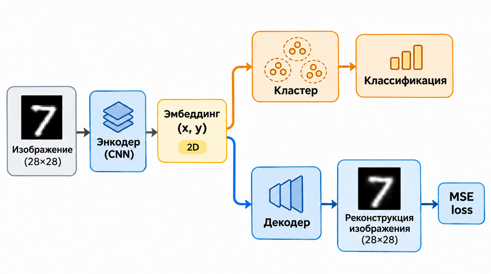

<details>
<summary><b>Показать слои Encoder и Decoder</b></summary>

```python
class Encoder(nn.Module):
    def __init__(self):
        super().__init__()
        self.conv1 = nn.Conv2d(1, 16, kernel_size=3, padding=1)
        self.batchnorm1 = nn.BatchNorm2d(16)
        self.act1 = nn.ReLU()
        self.pool1 = nn.MaxPool2d(2)
        self.conv2 = nn.Conv2d(16, 32, kernel_size=3, padding=1)
        self.batchnorm2 = nn.BatchNorm2d(32)
        self.act2 = nn.ReLU()
        self.pool2 = nn.MaxPool2d(2)
        self.fc3 = nn.Linear(32 * 7 * 7, 64)
        self.act3 = nn.ReLU()
        self.dropout3 = nn.Dropout(0.3)
        self.fc4 = nn.Linear(64, 2)

class Decoder(nn.Module):
    def __init__(self):
        super().__init__()
        self.fc1 = nn.Linear(2, 64)
        self.act1 = nn.ReLU()
        self.fc2 = nn.Linear(64, 32 * 7 * 7)
        self.act2 = nn.ReLU()
        self.upsample3 = nn.Upsample(scale_factor=2, mode="nearest")
        self.conv3 = nn.Conv2d(32, 16, kernel_size=3, padding=1)
        self.batchnorm3 = nn.BatchNorm2d(16)
        self.act3 = nn.ReLU()
        self.upsample4 = nn.Upsample(scale_factor=2, mode="nearest")
        self.conv4 = nn.Conv2d(16, 1, kernel_size=3, padding=1)
        self.act4 = nn.Sigmoid()
```

*Здесь приведены определения слоев, полный `forward()` находится в коде проекта.*

</details>

#### Посмотрим на эмбеддинги

| Доля разметки: 5%  |  Доля разметки: 10% |
|---|---|
|  | 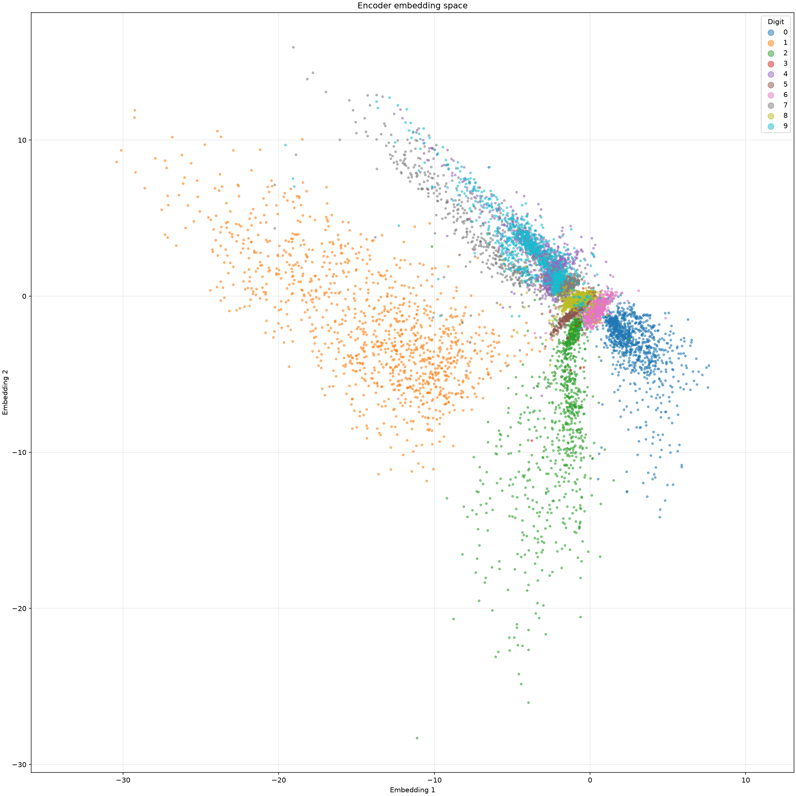 |


Кластеры в пространстве эмбеддингов сложно выделить чисто визуально. Впрочем, мы ведь собирались классифицировать изображения, а не только рисовать красивые диаграммы. Посмотрим, какую точность даст kNN.

#### Бенчмарк

| Доля разметки | kNN accuracy |
|---|---:|
|0.1% | 44.16% |
|0.2% | 55.85% |
|0.3% | 68.76% |
|0.5% | 74.13% |
|0.8% | 76.73% |
| 1%  | 77.57% |
| 2%  | 79.85% |
| 3%  | 80.29% |
| 5%  | 80.53% |
| 10% | 80.53% |

В целом такая версия уже может показывать неплохой результат. Accuracy держится примерно на уровне 80% при разметке от 2% -- для первой попытки это хорошо.

#### Вывод

KNN работает, что не может не радовать. Но вот четких кластеров у нас пока не получилось. \
Однако, возникает вопрос: а почему они вообще должны были появиться? Модель училась просто сжимать и восстанавливать изображение, ничего не зная про классы. Она, конечно, пыталась найти какие-то паттерны, но эти паттерны могли, например, характеризовать почерк и толщину линий, а не особенности написания цифр.

### 2.3 Классификатор

<b><u>Гипотеза:</u></b>  давайте добавим в модель простой классификатор, чтобы она училась разделять эмбеддинги разных цифр более явно. 

С классификатором архитектура становится немного сложнее: теперь появляется вторая loss-функция -- кросс-энтропия для классификации.

$$
LOSS = MSE + \alpha \cdot LOG, \qquad \alpha=1.
$$

То есть эмбеддинг по-прежнему участвует в реконструкции изображения (с помощью декодера), но теперь появляется еще и классификатор, который пытается предсказать класс по эмбеддингу. При этом `MSE` можно считать по всем обучающим картинкам, а `LOG` -- только по размеченным.

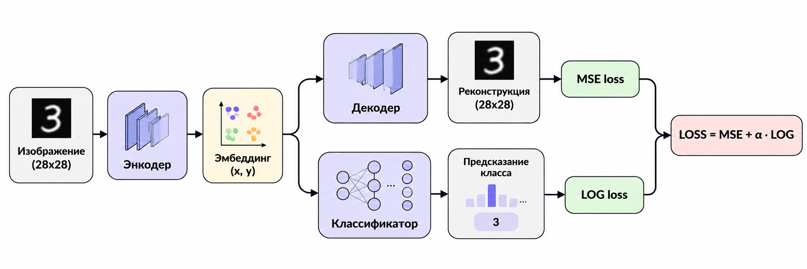

Сам классификатор намеренно очень простой -- один линейный слой `2 → 10`. Он возвращает десять логитов, по которым мы вычисляем кросс-энтропию. Слишком сложный и умный классификатор мог бы научиться предсказывать классы даже по нечетко разделенным эмбеддингам, а нам нужен противоположный эффект.

#### Посмотрим на эмбеддинги

| Доля разметки: 5%  |  Доля разметки: 10% |
|---|---|
| 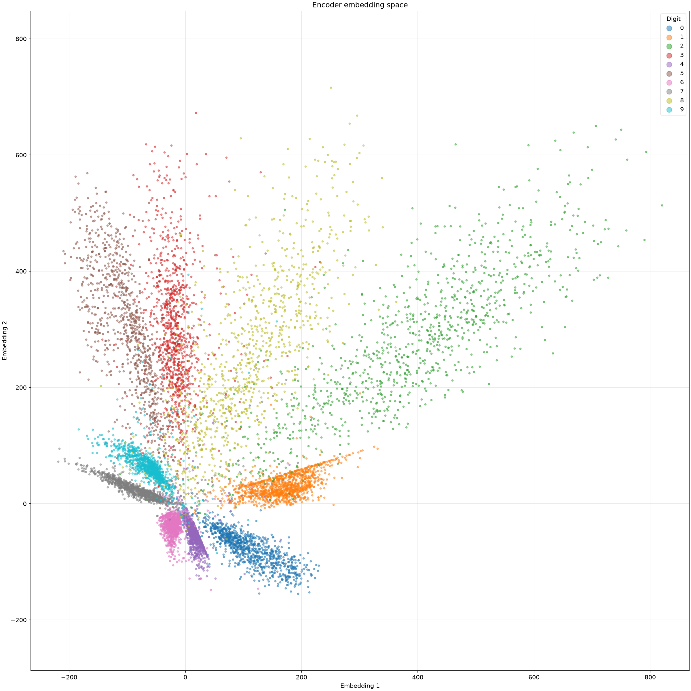 | 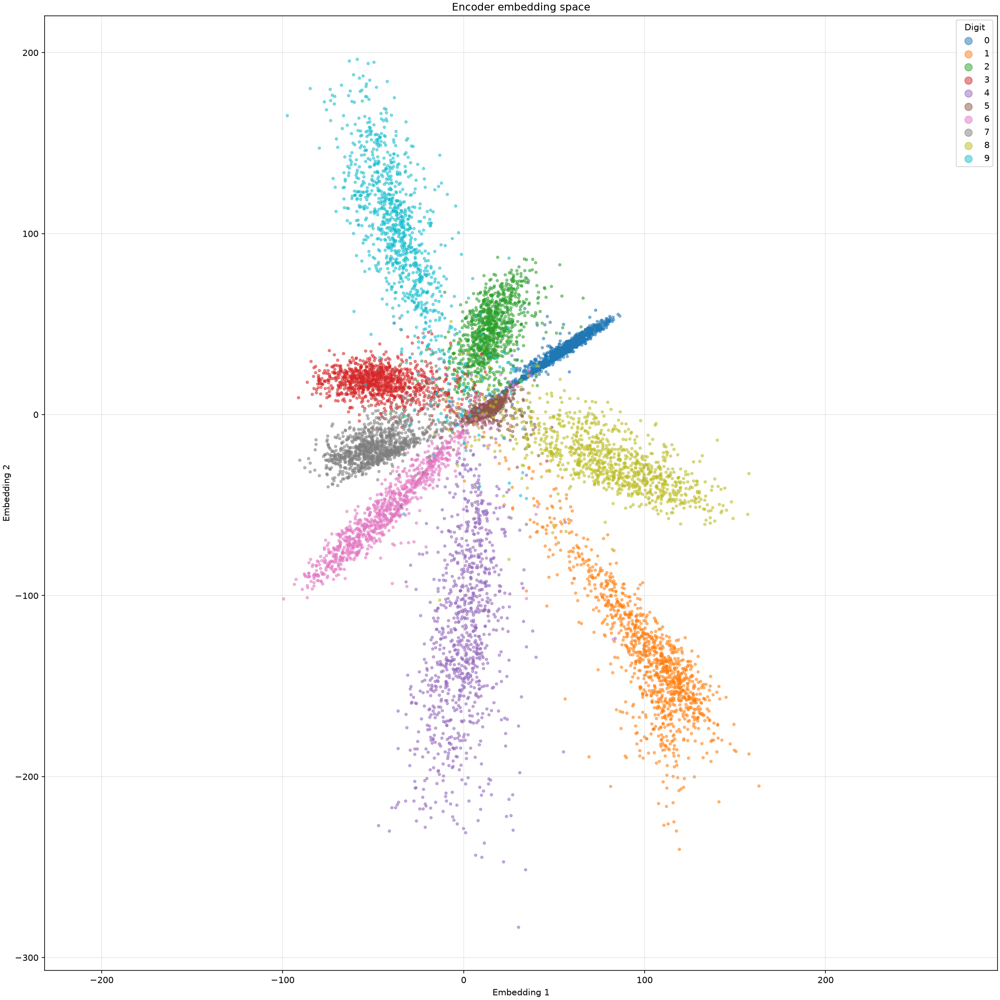 |

Визуально кластеры стали разделены сильно лучше. Значит, наша гипотеза выглядит правдоподобно, но давайте проверим ее по accuracy.

#### Бенчмарк

| Доля разметки | kNN accuracy | Classifier accuracy |
|---|---:|---:|
| 0.1% | 54.13% | 16.78% |
| 0.2% | 57.40% | 12.86% |
| 0.3% | 64.48% | 23.89% |
| 0.5% | 72.20% | 34.15% |
| 0.8% | 81.62% | 47.44% |
| 1%   | 77.80% | 49.01% |
| 2%   | 89.17% | 80.53% |
| 3%   | 90.38% | 88.69% |
| 5%   | 91.26% | 90.72% |
| 10%  | 93.94% | 93.18% |

Теперь мы можем предсказывать цифру не только с помощью kNN, но и самим классификатором, который обучили. Видим, что при небольшом количестве меток kNN обычно показывает более высокую accuracy, а 
при 3-10% разница становится гораздо меньше. 

Стоит отметить, что классификатор работает быстрее, поскольку ему не нужно искать ближайшие точки среди размеченных изображений, но производительность алгоритмов в данной работе не исследуется, поэтому оставим это в качестве ремарки.

#### Вывод

Добавление классификатора действительно помогло нам лучше разделить эмбеддинги и повысило точность kNN на большинстве долей разметки. \
Однако появилась новая проблема: теперь кластеры сильно вытягиваются. Хотелось бы добиться более компактного расположения точек.

### 2.4 Геометрический критерий

<b><u>Гипотеза:</u></b> давайте введем еще один критерий для обучения сети, контролирующий геометрию кластеров: будем штрафовать ее за слишком большой разброс точек внутри класса и поощрять за далеко расположенные друг от друга кластеры.

Сформулируем эту идею математически:

$$
GEOM = \frac{W}{B},
$$

где `W` (*within variance*) -- средняя дисперсия точек внутри кластеров, а `B` (*between variance*) -- дисперсия центров кластеров. 

Минимизация этого отношения поощряет компактные и удаленные друг от друга группы. Для этого нам не нужна новая голова нейросети, достаточно добавить еще одно слагаемое к функции потерь:

$$
LOSS = MSE + \alpha \cdot LOG + \beta \cdot GEOM.
$$

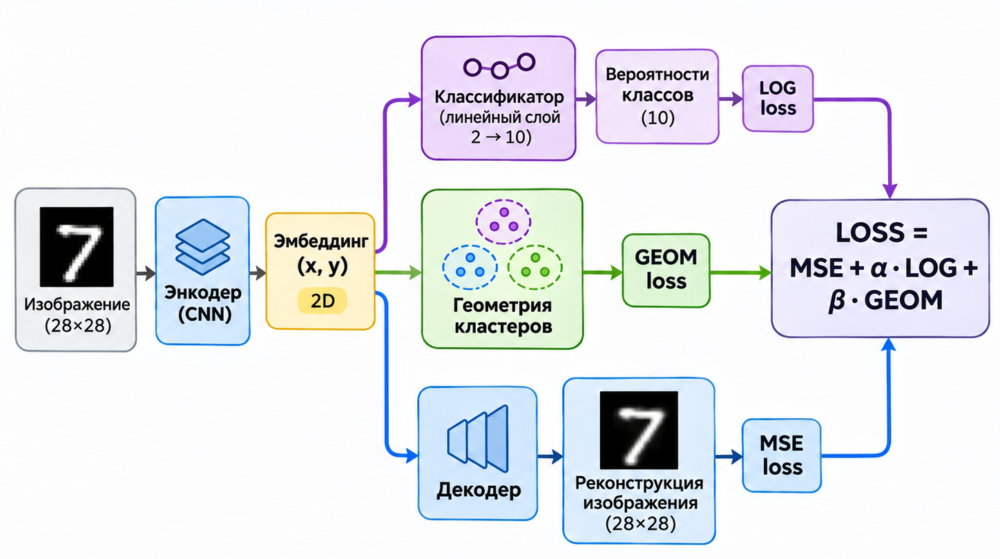

**Какой коэффициент β выбрать?** 

Обучим несколько моделей с разными значениями и сравним accuracy при **10% разметки**:

| Значение β | kNN accuracy | Classifier accuracy |
|---:|---:|---:|
| 1   | 93,98%       | 93,76%       |
| 2   | 95,10%       | **95,21%** |
| 3   | 92.64%       | 92.24%       |
| 4   | **95,28%** | 94,59%       |
| 10  | 88,90%       | 88,85%       |
| 50  | 90,99%       | 90,38%       |
| 80  | 93,75%       | 93,50%       |
| 100 | 92,65%       | 91,68%       |
| 110 | 91,58%       | 90,95%       |
| 130 | 72,20%       | 69,97%       |

В этой серии лучшие результаты получились при $\beta=2$ и $\beta=4$. Для дальнейших экспериментов выберем:
$$\boxed{\beta = 2}$$

#### Посмотрим на эмбеддинги

| Доля разметки: 5%  |  Доля разметки: 10% |
|---|---|
| 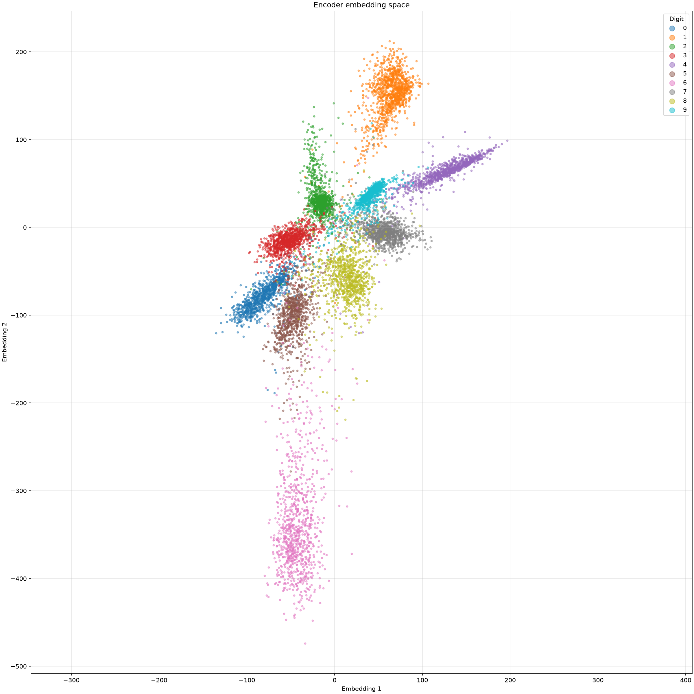 | 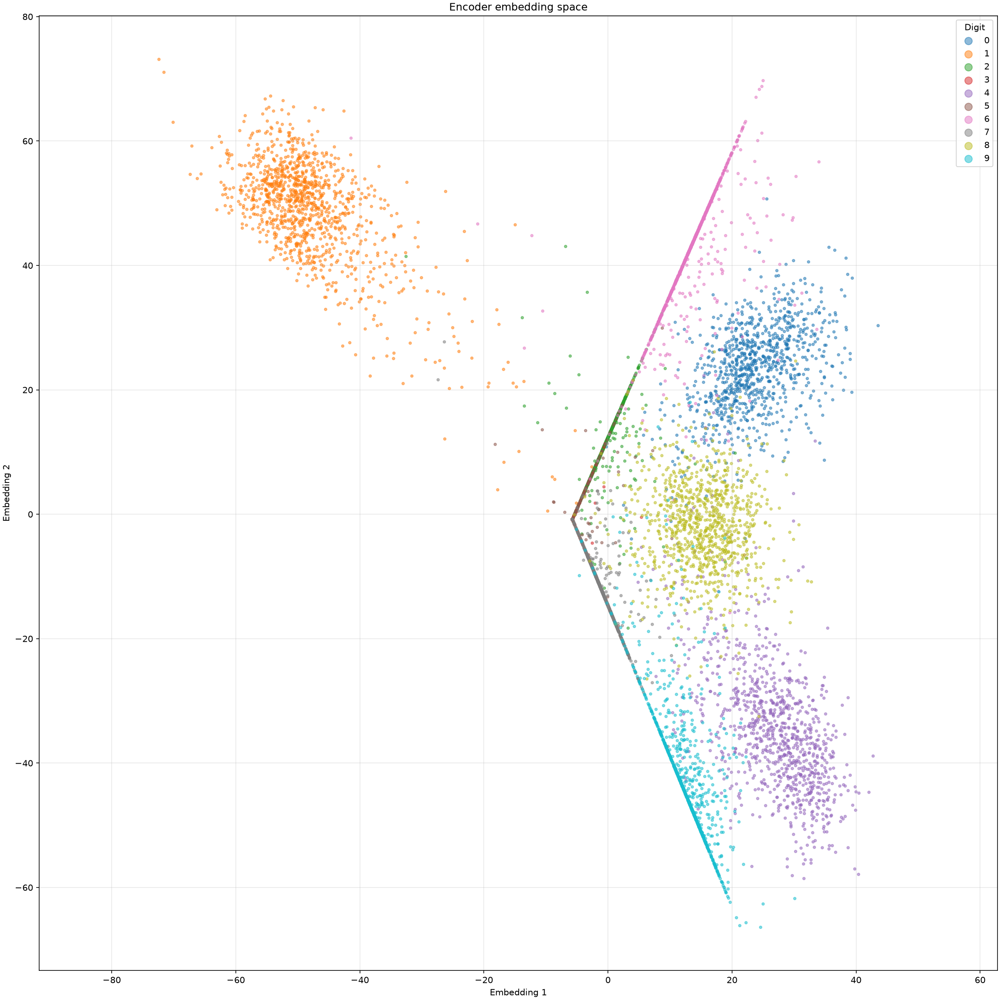 |

Интересная картина наблюдается в скрытом пространстве сети. При 5% разметки кластеры стали более выраженными, однако при увеличении доли до 10% одна часть вытягивается в тонкие прямые линии, а другая формирует обособленные компактные облака.

#### Похоже ли это на то, что мы ожидали?

Конечно, зависит от того, что именно мы ожидали, но все-таки я был немного удивлен. Казалось, что кластеры должны становиться более округлыми, а не превращаться в линии. Но, видимо, сеть решила именно так оптимизировать дисперсию. И за это винить ее нельзя -- наш критерий вовсе не требует обязательно круглых кластеров, он лишь уменьшает дисперсию точек.

#### Бенчмарк

| Доля разметки | kNN accuracy | Classifier accuracy |
|---:|---:|---:|
| 0,1% | 57,86% | 20,63% |
| 0,2% | 63,47% | 21,01% |
| 0,3% | 68,40% | 36,57% |
| 0,5% | 63,59% | 42,29% |
| 0,8% | 73,15% | 69,07% |
| 1%   | 87,54% | 79,92% |
| 2%   | 92,03% | 91,29% |
| 3%   | 88,47% | 86,93% |
| 5%   | 91,42% | 91,01% |
| 10%  | 95,67% | 95,36% |

Здесь результаты уже не такие однозначные. Например, при 1% разметки kNN accuracy выросла с 77,80% до **87,54%**, а при 2% -- с 89,17% до **92,03%**. Но при 0,5%, 0,8% и 3% разметки новая модель, наоборот, уступила предыдущей.

#### Вывод

Получается, геометрический критерий действительно может улучшать accuracy, но вовсе не гарантирует этого при любом количестве меток. Кроме того, хоть некоторые кластеры и стали компактнее, другие вытянулись в линии.

### 2.5 Аугментации

<b><u>Гипотеза:</u></b> давайте теперь попробуем хорошо известный в ML прием -- аугментацию исходного изображения. В нашем случае это будет небольшой случайный поворот картинки, не более чем на 10°.

Предположим, что такой поворот заставит модель ориентироваться на более общие паттерны, а не на точное положение штрихов. Может быть, это поможет и лучше разделить кластеры.

#### Посмотрим на эмбеддинги

| Доля разметки: 5%  |  Доля разметки: 10% |
|---|---|
| 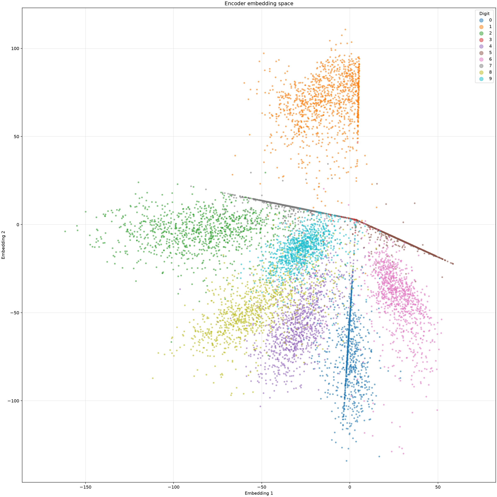 | 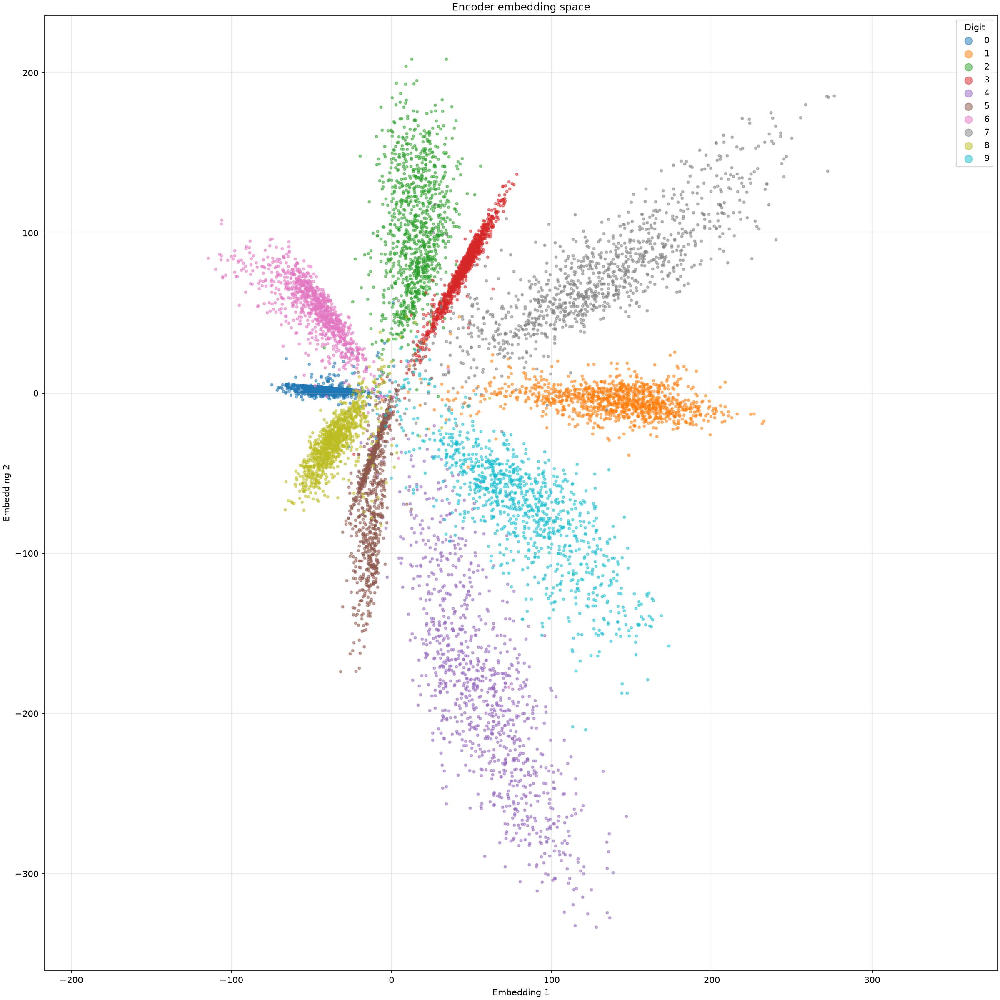 |

На данный момент чисто визуально это один из лучших результатов, которых удалось достичь. Исчезла проблема предыдущей модели, которая вытягивала кластеры в узкие линии. Теперь каждый кластер растет преимущественно радиально в своем направлении.

Казалось бы, такое четкое разделение должно давать хорошие результаты на бенчмарках -- это сейчас и проверим.

#### Бенчмарк

| Доля разметки | kNN accuracy | Classifier accuracy |
|---:|---:|---:|
| 0,1% | 46,07% | 14,13% |
| 0,2% | 57,51% | 19,71% |
| 0,3% | 65,29% | 53,37% |
| 0,5% | 77,59% | 67,67% |
| 0,8% | 76,07% | 56,69% |
| 1%   | 90,52% | 85,17% |
| 2%   | 91,54% | 91,30% |
| 3%   | 93,86% | 93,38% |
| 5%   | 90,11% | 88,37% |
| 10%  | 95,70% | 95,50% |

Тут, однако, результаты снова неоднозначные. Значительный прирост kNN accuracy наблюдается при 0,5%, 1% и 3% разметки. А вот при 0,1-0,3% она, наоборот, уменьшилась относительно модели без аугментаций.

#### Вывод

Таким образом, нельзя сказать, что новая модель однозначно выигрывает у предыдущей. Наша гипотеза насчет четкой радиальной структуры кластеров оправдалась не в полной мере -- красивые эмбеддинги еще не гарантируют максимальную точность предсказаний.

**Проблема:** в ходе обучения обнаружилось слабое место аугментаций -- скорость обучения упала кратно. Рассмотрим это отдельно.

### 2.6 Сравнение скорости обучения

| Модель | Характерное время обучения, с/эпоху |
|---|:---|
| autoencoder | 1.7 |
| class       | 3.5 |
| geom        | 3.5 |
| rot         | 29  |

Повороты замедлили обучение более чем в **8 раз** по сравнению с моделью без аугментаций, прежде всего из-за дополнительной обработки изображений. 

Стоит отметить, что это особенность текущей реализации, а не обязательная цена аугментаций. Например, параллельная загрузка батчей в 4 потока уже уменьшила время примерно до **14 с/эпоху**, но повторюсь, производительность не является целью нашего исследования.

## 3. Сравнение архитектур

### 3.1 Проанализируем 4 обученные архитектуры
Для наглядности представим результаты четырех вариантов с эмбеддингами на графиках:

| Сравнение knn  |  Сравнение классификаторов |
|---|---|
| 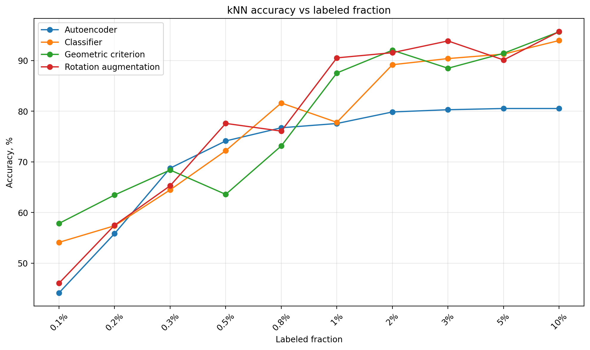 | 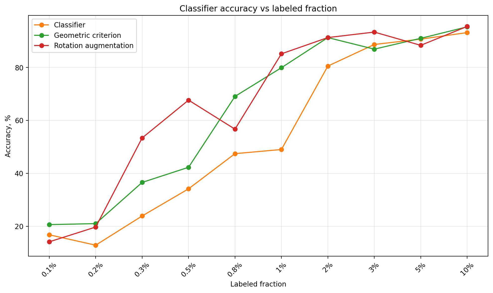 |

| Сравнение всех knn и классификаторов | Сравнение лучших knn и классификатора |
|---|---|
| 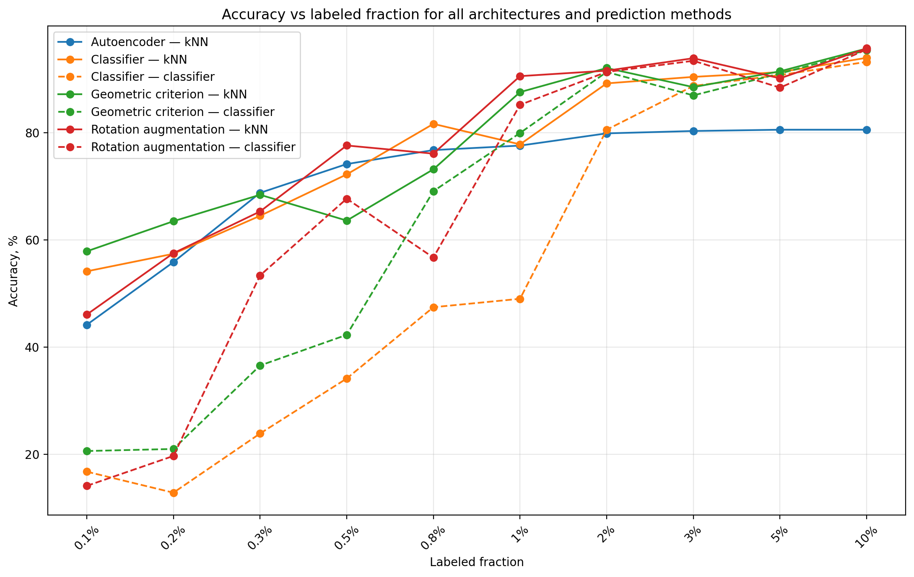 | 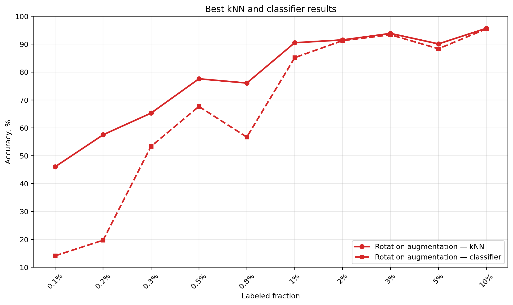 |

Итак, хуже всего в целом себя показала первая архитектура -- обычный автоэнкодер. \
А вот дальше ситуация интереснее. Среди остальных моделей однозначного лидера нет: каждая при некоторых долях разметки выигрывает, а при других проигрывает. 

Из полученных данных можно сделать несколько выводов: 
- kNN почти всегда точнее классификатора, особенно при малом количестве меток.
- Геометрический критерий и повороты помогают не всегда, а красивые кластеры сами по себе еще не означают высокую accuracy.
- Модель с аугментациями по сравнению с предыдущими все-таки показывает более высокие и стабильные результаты, однако это преимущество не является абсолютным и не обязывает всегда отдавать предпочтение именно этой архитектуре.

### 3.2 Контрольный эксперимент: сравнение с CNN 

Но остается важный вопрос: **помогло ли использование неразмеченных изображений?** \
Для сравнения обучим обычную CNN, которая видит только доступные размеченные примеры. При этом оставим **двумерное ограничение**, чтобы сравнение не сводилось просто к разнице в размерности скрытого пространства:

```text
Изображение → сверточные блоки → 1568 → 64 → ReLU → 2 → 10
|                                                    |
|----------------------------------------------------|
    Часть CNN, идентичная энкодеру в наших моделях     
```
Модель обучалась по `CrossEntropyLoss`, лучшая эпоха выбиралась по validation accuracy.


| Доля разметки: 3%  |  Доля разметки: 5% |
|---|---|
| 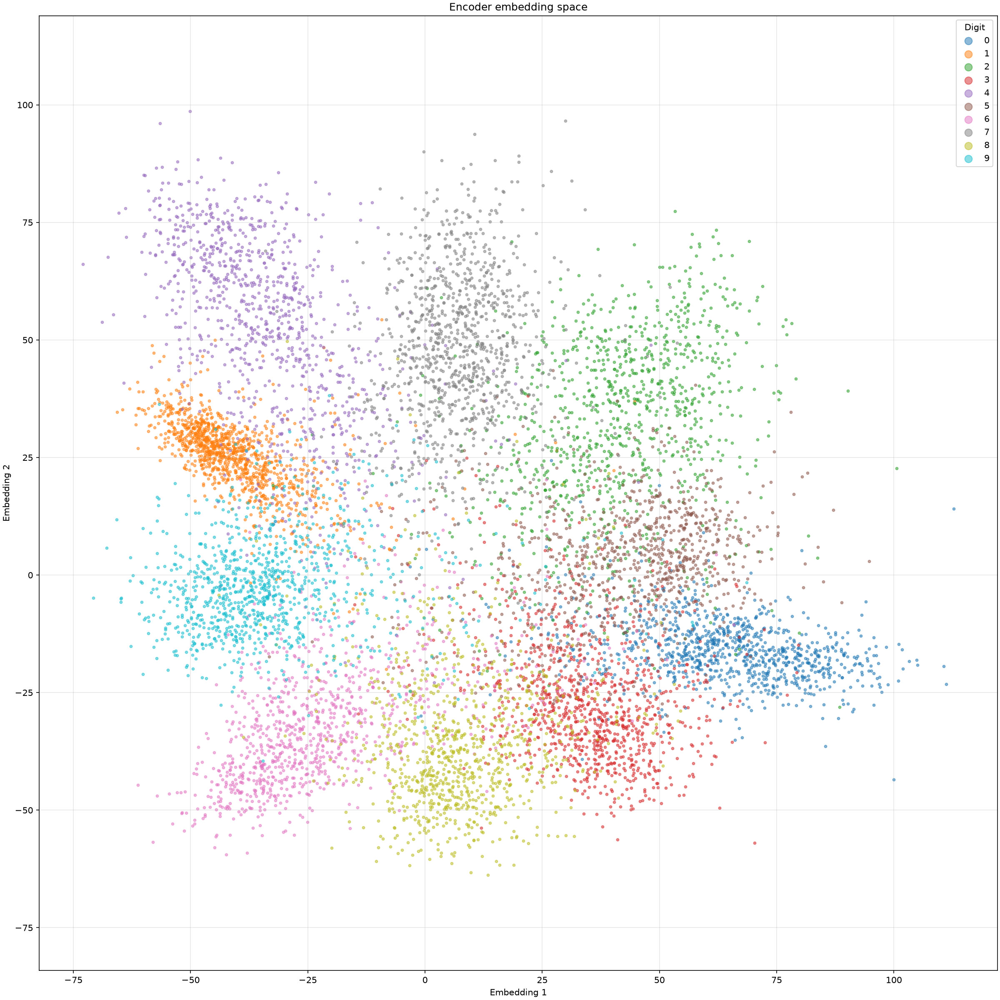 | 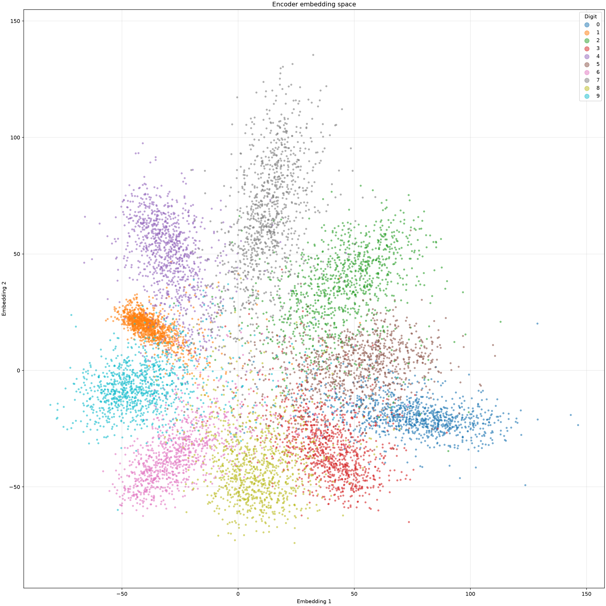 |


В последнем столбце -- **лучший kNN среди четырех архитектур для каждой доли разметки**. Это максимум по разным экспериментам, а не одна фиксированная модель.

Из карты эмбеддингов видно, что кластеры более разрежены и сильнее перемешаны, хоть и неплохо различимы на глаз.

| Доля разметки | Размеченных изображений | Лучшая эпоха CNN | Validation accuracy | CNN test accuracy | Лучший kNN test accuracy |
|---|---:|---:|---:|---:|---:|
| 0,1% | 55    | 94 | 40,36% | 39,29% | **57,86%** |
| 0,2% | 110   | 69 | 44,80% | 43,45% | **63,47%** |
| 0,3% | 165   | 70 | 49,72% | 48,16% | **68,76%** |
| 0,5% | 275   | 53 | 57,54% | 55,20% | **77,59%** |
| 0,8% | 440   | 43 | 60,94% | 60,09% | **81,62%** |
| 1%   | 550   | 89 | 65,66% | 65,29% | **90,52%** |
| 2%   | 1 100 | 45 | 74,12% | 74,02% | **92,03%** |
| 3%   | 1 650 | 71 | 78,92% | 79,02% | **93,86%** |
| 5%   | 2 750 | 55 | 82,72% | 83,21% | **91,42%** |
| 10%  | 5 500 | 90 | 91,12% | 92,08% | **95,70%** |

Любопытно отдельно посмотреть на предельную точность CNN, достигнутую при полной разметки всего датасета:
$$\boxed{98.32\%}$$

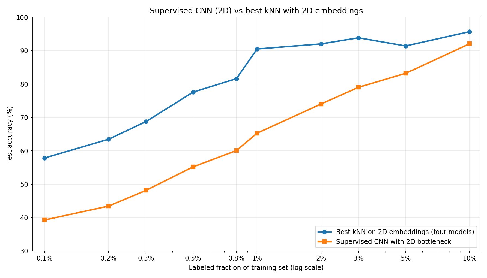

И вот теперь результат действительно интересный: **при одинаковом ограничении до 2-мерных эмбеддингов наши модели точнее на всех долях разметки от 0,1% до 10%**. \
Например, при 1% меток лучший kNN достиг 90,52% против 65,29% у CNN, а при 10% -- 95,70% против 92,08%. 

Однако приписывать всю разницу исключительно неразмеченным изображениям было бы некорректно: кроме данных, отличаются функции потерь и способ получения предсказания.

К слову, на полностью размеченном наборе CNN показала **98,01%**, что конечно выше, чем у наших моделей. Но этот эксперимент носит скорее развлекательный характер: все-таки модели были поставлены в абсолютно разные условия.

## 4. Итоги и ограничения

Для моделей с двумерными эмбеддингами удалось получить **90,52% accuracy при 1% разметки** и **95,70% при 10%**. Добавление классификатора улучшило разделение кластеров, геометрический критерий и аугментации тоже помогали, хотя и не на всех долях разметки. При этом kNN обычно показывал более высокую точность, чем простая линейная голова.

Самый показательный результат дал контрольный эксперимент: **CNN с тем же ограничением до 2D, обученная только на размеченных изображениях, уступила нашим моделям на всех проверенных долях от 0,1% до 10%**. Это поддерживает идею комбинировать размеченные и неразмеченные данные, хотя не позволяет отделить их вклад от особенностей архитектуры и обучения.

#### Ограничения и планы
Эксперименты выполнены только на MNIST, с намеренно двумерным пространством и без нескольких независимых запусков для каждой конфигурации. Возможно, увеличение размерности эмбеддинга улучшило бы классификацию -- но это уже тема следующего исследования.

---

## Приложение. Установка и запуск

### Установка

```bash
git clone https://github.com/9kazz/mnist_claster
cd mnist_claster
python3 -m venv .venv
source .venv/bin/activate
python -m pip install torch torchvision matplotlib numpy pillow tqdm
```

Нужен Python 3.10+. Для графического редактора `draw.py` также требуется Tkinter.

### Обучение -- `run_train.py`

```bash
python run_train.py --device cpu --epoch 50 --labeled 0.05 \
  --model-dir saved_models/my_model.pt --log-dir logs/my_model.csv
```

| Опция | Назначение | По умолчанию |
|---|---|---|
| `--device` | CPU / CUDA | `cuda` |
| `--epoch` | Число эпох | `50` |
| `--labeled` | Доля разметки | `0.1` |
| `--rotation` | Аугментация поворотами | Выключено |
| `--model-dir` | Путь для весов | `model.pt` |
| `--log-dir` | CSV-лог | `train.csv` |

Коэффициенты классификации и геометрии задаются в `src/train.py` (`COEF_CLASS`, `COEF_GEOM`).

### Проверка -- `run_benchmark.py`

```bash
python run_benchmark.py --device cpu \
  --model-dir saved_models/geom2_50ep_5lab.pt --knn-set 0.05 \
  --train-log logs/geom2_50ep_5lab.csv --log-dir bench_results/geom2_5lab \
  --num-pairs 5
```

Скрипт рассчитывает accuracy классификатора и kNN, показатели loss и при необходимости сохраняет графики.

### Рисование цифр -- `draw.py`

```bash
python draw.py --model-file saved_models/geom2_50ep_5lab.pt \
  --device cpu --knn-set 0.05 --neighbors 10
```

Откроется окно, в котором можно нарисовать цифру и получить предсказание. Подробные параметры каждого скрипта доступны через `--help`.

### Файлы и обозначения

| Директория | Содержимое |
|---|---|
| `saved_models/` | Сохраненные веса `.pt` |
| `logs/` | CSV-логи обучения |
| `bench_results/` | Графики и результаты |
| `data/` | MNIST |

| Префикс модели | Принцип обучения |
|---|---|
| `autoencoder` | Реконструкция |
| `class` | Реконструкция + классификация |
| `geomN` | Дополнительно геометрический критерий с β = N |
| `rotN` | Геометрический критерий и повороты |
